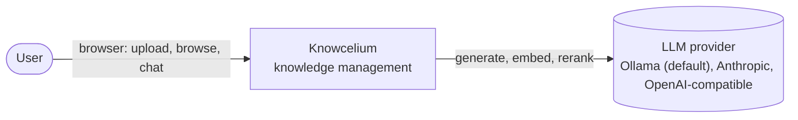
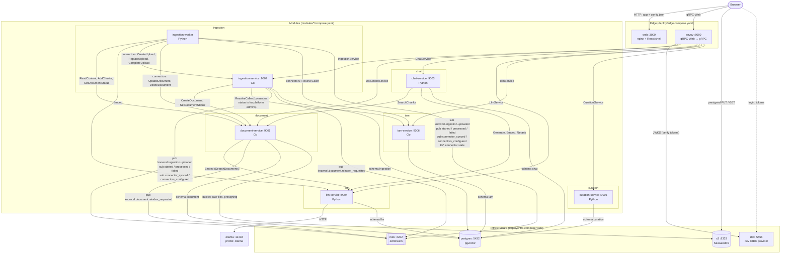

# Architecture overview

How the modules, the infrastructure and the browser fit together. The diagrams follow `compose.yaml` (and the fragments it includes) and the module manifests in `modules/*/module.yaml`; update them when either changes. The reasons behind the structure are recorded as [ADRs](../adr/README.md); the inside of a module is described in [module.md](module.md).

## System context



A user works with Knowcelium only through the browser. Its only external dependency is an LLM provider, reached exclusively through the `llm` module ([ADR 0005](../adr/0005-llm-module-is-the-only-vendor-gateway.md)).

## Containers



| Container | Module | Owns | Calls (gRPC) | Events |
|---|---|---|---|---|
| `document-service` | document | schema `document` (documents, chunks + `vector(768)`), S3 bucket, stream `DOCUMENT` | llm (`SearchDocuments`, and the current model for `ReindexDocuments`) | publishes `reindex_requested` ([Changing the embedding model](../operations/embedding-model.md)) |
| `ingestion-service` | ingestion | schema `ingestion` (jobs, connector status), stream `INGESTION` | document; iam for the connector status | publishes `uploaded`; consumes `started`, `processed`, `failed`, `connector_synced`, `connectors_configured`, and the document module's `reindex_requested` |
| `ingestion-worker` | ingestion | key-value bucket `ingestion_connectors` (connector sync state) | document, llm; ingestion and iam for [connectors](../operations/connectors.md) | consumes `uploaded`; publishes `started`, `processed`, `failed`, `connector_synced`, `connectors_configured` |
| `chat-service` | chat | schema `chat` (conversations, messages) | document, llm | — |
| `llm-service` | llm | schema `llm` (usage of generations), provider registry | Ollama over HTTP, Anthropic API | — |
| `iam-service` | iam | schema `iam` (users) | — | — |
| `curation-service` | curation | schema `curation` (scaffold: no scores or findings yet) | — (planned: document, llm, iam) | — (planned: consumes `knowcel.ingestion.processed`) |
| `envoy` | — | per-method routes for the public RPCs of each manifest's `grpc_services` (not `internal`); token check, sets `x-kb-user`, `x-kb-email` and `x-kb-name` ([ADR 0009](../adr/0009-oidc-authentication-at-the-gateway.md), [ADR 0013](../adr/0013-iam-module.md)) | all services | — |
| `web` | — | UI shell; module UIs from `apps/web/src/modules.gen.ts` | via envoy | — |

Modules never share a schema, bucket or stream: each is owned by one module, and other modules go through its gRPC API or its events ([ADR 0002](../adr/0002-module-per-folder-monorepo.md), [ADR 0004](../adr/0004-nats-jetstream-events-between-modules.md)).

## Access control

Documents are private to their owner and can be shared with teams; model management is limited to platform admins. Users, teams and roles live in `iam`, and the other modules enforce access with a caller context they resolve from it. The access matrix, the team rules and the behaviour while IAM is down are in [Access control](access-control.md).

## Upload → process → chat

```mermaid
sequenceDiagram
    autonumber
    actor U as Browser
    participant E as envoy
    participant I as ingestion-service
    participant D as document-service
    participant S3 as s3
    participant N as nats (INGESTION)
    participant W as ingestion-worker
    participant L as llm-service
    participant C as chat-service

    U->>E: IngestionService.CreateUpload
    E->>I: CreateUpload
    I->>D: CreateDocument
    D-->>I: document + presigned PUT URL
    I-->>U: job + upload URL
    U->>S3: PUT file (presigned)
    U->>I: CompleteUpload (via envoy)
    I->>D: SetDocumentStatus(UPLOADED)
    I->>N: knowcel.ingestion.uploaded
    U->>I: WatchJob (server stream, via envoy)

    N->>W: DocumentUploaded
    W->>N: knowcel.ingestion.started
    W->>D: SetDocumentStatus(PROCESSING)
    W->>D: ReadContent (stream)
    W->>W: extract + chunk
    W->>L: Embed(chunks)
    W->>D: AddChunks(text, embeddings), marks READY
    W->>N: knowcel.ingestion.processed
    N->>I: started / processed (or failed)
    I-->>U: job updates on WatchJob

    U->>C: ChatService.StreamChat (via envoy)
    Note over C: answer runs in a detached task;<br/>StreamChat follows it, StopChat stops it
    alt platform knowledge on, KNOWCEL_AGENTIC on and the model supports tools (ListModels)
        loop at most KNOWCEL_MAX_TOOL_STEPS tool calls
            C->>L: Generate(system prompt, tools) (stream)
            L-->>C: tool call: search_knowledge_base, search_connectors or read_document
            Note over C,I: search_knowledge_base: Embed, SearchChunks, Rerank when enabled<br/>search_connectors: SearchConnectors<br/>read_document: GetDocument, ListChunks
            C-->>U: retrieval step: query, state, result count
            Note over C: results get [n] numbers, kept across calls
        end
        C->>L: Generate(history + tool results, no tools) (stream)
    else fixed pipeline: agentic off or a model without tool support
        C->>L: Embed(question)
        C->>D: SearchChunks(embedding, question text)
        C->>I: SearchConnectors(question)
        C->>L: Rerank(question, candidate chunks)
        C->>L: Generate(system prompt + chunks) (stream)
    end
    C-->>U: answer tokens + citations (stream)
```

With tools the model decides when to search and what for: a greeting triggers no search, a follow-up is searched with the words the model picks, not verbatim. Every call is saved as a step (query, state, result count) on the assistant message, so the user sees the same steps after a reload; the live stream carries them as `retrieval` events. Stopping the answer cancels a tool call in flight and keeps the partial answer. A connector that is slow or down is reported to the model as unavailable and the answer still arrives. [ADR 0016](../adr/0016-chat-tool-calling.md) records why this is native tool calling in `llm` and not LangChain.

On a processing error the worker sets the document to `FAILED` and publishes `knowcel.ingestion.failed` instead; the ingestion service marks the job failed. JetStream redelivers an unacknowledged `uploaded` event up to three times.
